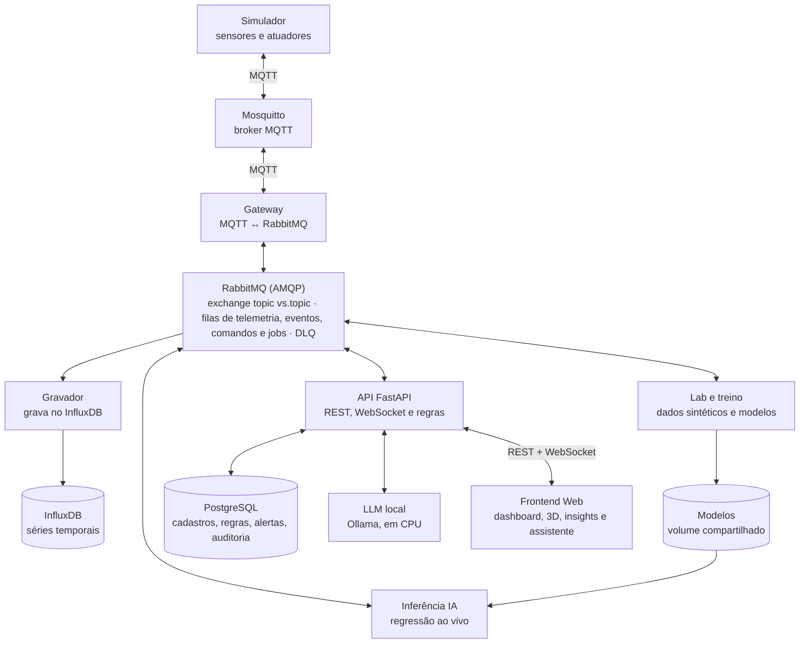

# VacinaSegura · AIoT

Monitoramento das geladeiras de vacinas das unidades básicas de saúde (UBS), com IoT, IA e um gêmeo digital 3D.

## Problema

As vacinas precisam ficar entre **+2 °C e +8 °C**. Em muitas UBS a temperatura ainda é conferida à mão algumas vezes por dia e anotada em papel. Se a geladeira falha à noite, ou a porta fica mal fechada no fim de semana, ninguém percebe, e lotes inteiros de vacinas vão para o lixo. Quase sempre a causa é o **compressor**, que se desgasta aos poucos antes de parar de vez.

O VacinaSegura:

- mede de forma contínua a temperatura, a umidade, a porta, a sala e o compressor de cada geladeira;
- liga um **alarme automático** quando a temperatura sai da faixa;
- deixa a equipe acionar pela Web o **resfriamento de emergência** e a luz da sala;
- usa **IA (regressão)** para prever a **vida útil restante** e o **índice de saúde** do compressor, avisando antes da falha;
- mostra tudo num **dashboard**, num **gêmeo digital 3D** ao vivo e num **assistente com LLM local**.

> 1º bimestre: protótipo com ESP32 + DHT22 no Wokwi, MQTT, InfluxDB e dashboard Vue. O código antigo está em [`legado/`](legado/).
> 2º bimestre: aplicação AIoT completa, descrita abaixo.

## Arquitetura



| Camada | Tecnologia | Papel no projeto | Pasta |
|---|---|---|---|
| Dispositivo | Simulador em Python | Sensores, compressor e atuadores. Publica telemetria e obedece aos comandos | `servicos/vacinasegura/simulador` |
| IoT (borda) | MQTT + Mosquitto | Liga o dispositivo à aplicação, nos dois sentidos, sem acesso anônimo e com ACL por tópico | `infra/mosquitto` |
| Gateway | Python (paho-mqtt + aio-pika) | Lê o MQTT e republica no RabbitMQ; leva os comandos de volta ao MQTT | `servicos/vacinasegura/gateway` |
| Mensageria | RabbitMQ | Barramento interno: exchange topic, filas por consumidor, DLQ e um usuário por serviço | `servicos/vacinasegura/rabbit_init` |
| Séries temporais | InfluxDB 2 | Leituras e previsões ao vivo (bucket `leituras`) e amostra sintética (bucket `lab`) | `servicos/vacinasegura/gravador` |
| Relacional | PostgreSQL 16 | Usuários, dispositivos, regras, configurações, alertas, jobs, modelos e auditoria | `servicos/vacinasegura/api/db.py` |
| IA | scikit-learn | Gerador sintético, treino (RUL e saúde) e inferência em tempo real | `servicos/vacinasegura/lab`, `inferencia` |
| LLM local | Ollama (`llama3.2:3b`, em CPU) | Assistente que responde sobre os dados, sem nuvem | `servicos/vacinasegura/api/assistente.py` |
| Backend | Python + FastAPI | API REST, WebSocket, regra de negócio, JWT e auditoria | `servicos/vacinasegura/api` |
| Frontend | Vue 3 + TypeScript + Vite | Dashboard (ECharts), gêmeo 3D (Three.js) e demais páginas | `frontend/` |
| Infraestrutura | Docker + Docker Compose | Sobe tudo com um comando, com healthchecks e ordem de subida | `docker-compose.yml` |

### Dispositivos (cadastro inicial)

Duas UBS (**UBS Centro** e **UBS Vila Nova**), cada uma com duas geladeiras:

| Tipo | Itens | Observação |
|---|---|---|
| Sensores | temperatura interna, umidade, porta (por geladeira); temperatura e luminosidade da sala (por UBS) | 5 tipos de sensor |
| Equipamento monitorado | **compressor** de cada geladeira: vibração (mm/s), corrente (A) e temperatura do compressor (°C) | alimenta a manutenção preditiva |
| Atuador automático | **alarme sonoro**: ligado pela regra "temperatura fora de +2 a +8 °C", com histerese | regra no PostgreSQL |
| Atuadores pela Web | **resfriamento de emergência** (por geladeira) e **luz da sala** (por UBS) | o resfriamento ligado baixa a temperatura nas leituras seguintes |

Cada leitura do simulador vale **5 minutos simulados** e sai a cada 5 s reais, então um dia simulado passa em uns 24 min. O gerador sintético e o simulador usam **a mesma física** (`comum/fisica.py`).

### Mensageria (RabbitMQ)

Exchange `vs.topic` (topic). Routing keys e filas:

| Routing key | Publicado por |
|---|---|
| `telemetry.<ubs>.<tipo>.<dispositivo>` | gateway |
| `command.<ubs>.<dispositivo>` | API |
| `prediction.<ubs>.<equipamento>` / `alert.<ubs>.<equipamento>` | inferência |
| `job.request.geracao` / `job.request.treino` | API |
| `job.progress.<tipo>` / `job.done.<tipo>` | lab |

| Fila | Consumidor | Recebe |
|---|---|---|
| `q.gravador` | gravador → InfluxDB | `telemetry.#`, `prediction.#` |
| `q.inferencia` | inferência IA | `telemetry.*.compressor.*` |
| `q.websocket` | API → navegadores | telemetria, previsões, alertas e jobs |
| `q.regras` | API (regra do alarme) | `telemetry.*.temperatura.*` |
| `q.api.eventos` | API → PostgreSQL | `alert.#`, `job.#` |
| `q.comandos` | gateway → MQTT → simulador | `command.#` |
| `q.jobs.geracao`, `q.jobs.treino` | lab e treino | jobs demorados |
| `q.dlq` | (exchange `vs.dlx`) | mensagens que falharam, preservadas |

Todas as mensagens, no MQTT e no RabbitMQ, usam o mesmo formato JSON:

```json
{"id": "uuid", "ts": "2026-11-20T13:00:00.000Z", "tipo": "telemetria", "dispositivo": "ubs01-g01-comp", "ubs": "ubs01",
 "conteudo": {"vibracao": 2.1, "corrente": 1.3, "temp_compressor": 41.2, "estado": "operando", "hora_sim": 13.0}}
```

Cada serviço tem um usuário no RabbitMQ só com as permissões de que precisa (sem `guest`):

| Usuário | Pode publicar em | Pode consumir |
|---|---|---|
| gateway | `telemetry.*` | `q.comandos` |
| gravador | nada | `q.gravador` |
| inferencia | `prediction.*`, `alert.*` | `q.inferencia` |
| lab | `job.progress.*`, `job.done.*` | `q.jobs.*` |
| api | `command.*`, `job.request.*` | `q.websocket`, `q.regras`, `q.api.eventos`, `q.dlq` (tag monitoring) |

### Inteligência artificial

- **Dados sintéticos** (página *Laboratório*): o gerador simula a vida inteira de dezenas a milhares de geladeiras, com numpy e em blocos. Por padrão são **60 equipamentos × 60 dias = 5,2 milhões de leituras**, com teto de 30 milhões. A degradação é progressiva, com 4 modos de falha do compressor (rolamento, entupimento, superaquecimento e desbalanceamento), falhas de sensor (deriva e travamento), ciclo diário e estações, ruído, leituras faltantes e outliers, tudo com semente reproduzível. Os rótulos (horas até falhar, índice de saúde) ficam só no arquivo de treino. Uma amostra vai para o bucket `lab` do InfluxDB.
- **Features** (`comum/features.py`): média, desvio, máximo e tendência em janelas de 1 h e 6 h que olham **só para o passado**. É o mesmo código no treino e na inferência; o teste `test_features_olham_so_o_passado` prova que não há vazamento.
- **Modelos**:
  - **RUL**: vida útil restante em horas, com teto de 168 h;
  - **índice de saúde**: de 0 a 100.

  Para cada alvo, o gradient boosting e o Ridge competem na validação. A divisão treino/validação/teste é **por equipamento**. A página *Treinamento* mostra MAE, RMSE, R², previsto × real, a importância dos atributos e a comparação com a base "prever sempre a média".
- **Inferência ao vivo**: aplica o modelo atual à telemetria que chega pelo RabbitMQ. O modelo novo entra em uso **sem reiniciar** o serviço. Os alertas têm **histerese**: 3 previsões seguidas para abrir e 10 para fechar.
  - **saúde < 50**: alerta de atenção;
  - **RUL < 24 h**: alerta crítico.

### Segurança

- Login com **JWT** e três papéis:
  - **visualizador**: só vê;
  - **operador**: comanda atuadores e simulador;
  - **administrador**: também gera dados, treina modelos, edita o cadastro e vê a auditoria.
- Senhas com **bcrypt**. Depois de 5 erros o usuário fica bloqueado por 5 min, e há um limite de tentativas por IP.
- **Nenhum segredo no Git**: o `.env` é gerado pelo script `gerar-segredos` e está no `.gitignore`. Não existe senha padrão.
- Mosquitto sem acesso anônimo e com ACL. RabbitMQ com um usuário por serviço e sem `guest`.
- O WebSocket usa um **ticket de uso único** que vale 30 s; o JWT nunca vai na URL.
- Containers da aplicação **sem root** e com sistema de arquivos somente leitura. Só a porta do frontend (8080) é publicada; InfluxDB, RabbitMQ e Adminer ficam em **127.0.0.1**.
- Tabela `auditoria` no PostgreSQL com logins, comandos (manuais e automáticos), jobs, alterações de cadastro e perguntas ao assistente.
- A saída do LLM é tratada como texto não confiável: Markdown sem HTML, sem imagens e sem links. Há limite de perguntas por minuto.

## Como subir

Pré-requisitos: **Git** e **Docker Desktop** (no Windows, com WSL2). Reserve pelo menos **8 GB de memória para o Docker**: no Windows, use o arquivo `%UserProfile%\.wslconfig` (veja abaixo). Node.js e Python não são necessários, porque tudo roda em containers.

```powershell
git clone https://github.com/RodolfoPZFilho/Vacina-Segura.git
cd Vacina-Segura
powershell -ExecutionPolicy Bypass -File gerar-segredos.ps1   # Linux/macOS: ./gerar-segredos.sh
docker compose up -d --build
```

O script mostra as senhas dos usuários de demonstração, que também ficam no `.env`. Abra **http://localhost:8080**.

Na primeira subida:

- o Docker baixa as imagens e o modelo `llama3.2:3b` (~2 GB);
- o serviço `lab` gera um conjunto de dados padrão e treina o primeiro modelo, o que leva 1 ou 2 minutos;
- acompanhe com `docker compose ps` e `docker compose logs -f lab ollama-preparar`.

| Endereço | O que é |
|---|---|
| http://localhost:8080 | Aplicação |
| http://127.0.0.1:15672 | RabbitMQ (usuário `vs-admin`) |
| http://127.0.0.1:8086 | InfluxDB (usuário `vacinasegura`) |
| http://127.0.0.1:8081 | PostgreSQL via Adminer (servidor `postgres`, usuário `vacinasegura`) |

### Usuários de demonstração

| Usuário | Papel |
|---|---|
| `administrador` | administrador |
| `operador` | operador |
| `visualizador` | visualizador |

As senhas são aleatórias, geradas por `gerar-segredos` e guardadas no `.env`; não ficam no repositório.

### Memória do Docker no Windows (WSL2)

Crie `%UserProfile%\.wslconfig` com:

```ini
[wsl2]
memory=8GB
```

Depois rode `wsl --shutdown` e abra o Docker Desktop de novo. O padrão é o `llama3.2:3b`, que responde melhor. Em máquinas com menos de 12 GB de RAM, troque para `OLLAMA_MODELO=llama3.2:1b` no `.env` (mais leve, respostas mais simples).

### Comandos úteis

```powershell
docker compose ps                 # estado e saúde de cada serviço
docker compose logs -f api        # logs de um serviço
docker compose stop gravador      # demonstração do consumidor parado
docker compose down               # para tudo (mantém os dados)
docker compose down -v            # para e APAGA os volumes (dados, modelos, LLM)
```

## Roteiro da demonstração

1. **IoT → Web.** No *Dashboard*, a telemetria chega ao vivo pelo caminho simulador → MQTT → gateway → RabbitMQ → gravador (InfluxDB) e API → WebSocket. O gráfico de histórico lê do InfluxDB.
2. **Web → IoT.** Entre como `operador` e ligue o **resfriamento de emergência** de uma geladeira. O comando segue API → RabbitMQ (`q.comandos`) → gateway → MQTT → simulador, e nas leituras seguintes o atuador aparece "ligado" e a temperatura cai. A luz da sala aumenta a luminosidade e acende a luminária no 3D.
3. **Regra de negócio.** No *Gêmeo 3D*, clique na porta de uma geladeira e em "Abrir a porta". Outra opção é injetar uma falha de compressor com poucas horas. Quando a temperatura passa de 8 °C, o **alarme** liga sozinho e abre um alerta; quando volta à faixa, desliga.
4. **IA.**
   - No *Laboratório*, como `administrador`, gere dados: a barra de progresso chega pelo WebSocket.
   - Em *Treinamento*, treine e compare as métricas com a base.
   - Em *Insights*, a geladeira **ubs01-g02** já começa com o rolamento gasto: a saúde cai, a vida útil diminui e os alertas preditivos aparecem.
   - A versão do modelo em uso muda sem reiniciar nada.
5. **3D.** A cena só se mexe com dados do WebSocket:
   - cores: normal, atenção, crítico e sem dados;
   - o compressor treme mais quanto maior a vibração;
   - a ventoinha gira e o alarme pisca;
   - dia e noite pela luminosidade, termômetro da sala, névoa fria da geladeira;
   - em "Pausar simulador 60 s" a cena para e avisa que não há dados.
6. **Mensageria.** Rode `docker compose stop gravador`: a fila `q.gravador` cresce na página *Mensageria*. Com `docker compose start gravador`, ela esvazia. A página mostra também as taxas, os consumidores, as últimas mensagens e a DLQ.
7. **Assistente.** Pergunte, por exemplo, "qual compressor está pior?", "o que significa o alerta?" ou "explique as métricas do treino". A resposta chega palavra por palavra, gerada pelo LLM local.
8. **Segurança e auditoria.** Entre como `visualizador` (sem botões de comando). Depois, como `administrador`, abra *Auditoria*.

## Estrutura

```
docker-compose.yml        orquestração de todos os serviços
gerar-segredos.ps1/.sh    gera o .env com senhas aleatórias
servicos/                 imagem Python única (cada serviço escolhe o módulo)
  vacinasegura/comum/     física, features, formato de mensagem, AMQP, InfluxDB
  vacinasegura/simulador/ dispositivo simulado (MQTT)
  vacinasegura/gateway/   MQTT ↔ RabbitMQ
  vacinasegura/gravador/  RabbitMQ → InfluxDB
  vacinasegura/inferencia/ previsões e alertas ao vivo
  vacinasegura/lab/       gerador sintético e treino
  vacinasegura/api/       FastAPI (REST, WebSocket, regras, auditoria, assistente)
  vacinasegura/rabbit_init/ topologia e usuários do RabbitMQ
  testes/                 testes de IA (pytest)
infra/                    Mosquitto (senhas e ACL) e preparo do Ollama
frontend/                 Vue 3 + TS + Vite, ECharts, Three.js, nginx
legado/                   código do 1º bimestre
```

## Desenvolvimento

```powershell
cd servicos
python -m venv .venv; .venv\Scripts\activate
pip install -r requirements.txt pytest
python -m pytest -q testes      # features sem vazamento, gerador, treino vence a base

cd ..\frontend
npm install
npm run build                   # checagem de tipos (vue-tsc) + build
```
